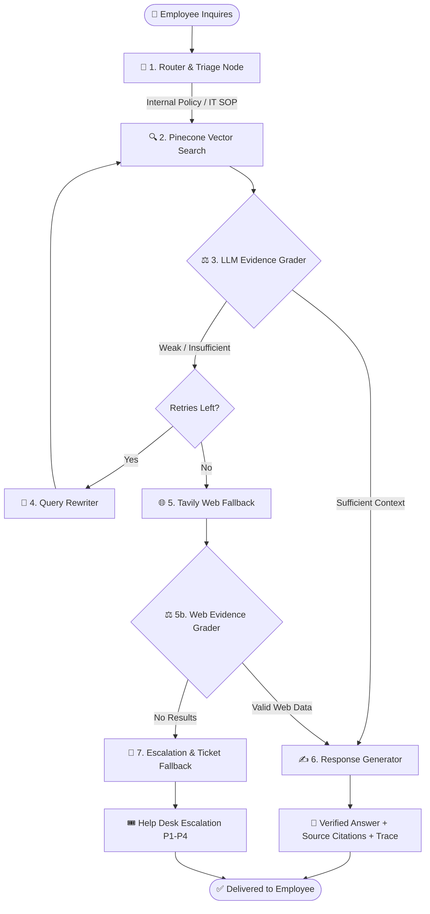

# 🛡️ Enterprise IT Support Copilot — Agentic RAG

[](https://www.typescriptlang.org/)
[](https://nodejs.org/)
[](https://react.dev/)
[](https://langchain-ai.github.io/langgraphjs/)
[](https://www.pinecone.io/)
[](https://groq.com/)
[](https://www.docker.com/)
[](https://opensource.org/licenses/MIT)

An enterprise-grade, self-correcting **Agentic Retrieval-Augmented Generation (RAG)** copilot designed to autonomously triage and resolve technical IT support inquiries, runbook tasks, and company policy questions.

Built entirely with **TypeScript / Node.js + React**, orchestrated with **LangGraph.js**, backed by **Pinecone Serverless Vector Search**, and fortified with **Tavily Web Search Fallback**.

---

## 🌟 Why Agentic RAG vs Traditional RAG?

| Capability | Traditional Linear RAG | This Enterprise Agentic Copilot |
| :--- | :--- | :--- |
| **Pipeline Flow** | Fixed: Question $\rightarrow$ Search $\rightarrow$ Answer | **Dynamic cyclical state machine** with conditional branching |
| **Evidence Validation** | ❌ Blindly feeds top-$k$ chunks to the LLM | ✅ **LLM-as-a-Judge grader** scores relevance before generation |
| **Query Reformulation** | ❌ If search terms fail, output hallucinations | ✅ **Autonomous Query Rewriter** optimizes keywords & retries |
| **Coverage Gaps** | ❌ Fails on live external cloud/SaaS outages | ✅ **Dynamic Web Search Fallback** (Tavily) with disclaimer |
| **Failure Handling** | ❌ Generic failure message | ✅ **Automated IT HelpDesk Escalation** (P1–P4 triage) |
| **Observability** | ❌ Black-box execution | ✅ **Real-time Agent Workflow Trace** exposed to user in UI |

---

## 🧠 System Architecture & Decision Graph

The agentic pipeline is orchestrated as a state machine using **LangGraph.js**:



---

## ⚙️ Tech Stack & Engineering Decisions

| Component | Technology | Rationale |
| :--- | :--- | :--- |
| **Orchestration** | **LangGraph.js** (`@langchain/langgraph`) | Provides cyclical graphs, conditional branching, and deterministic state transitions. |
| **LLM Inference** | **Groq API** (`qwen/qwen3.8-27b`) | Sub-second inference latency, ultra-cost effective for multi-step agent reasoning. |
| **Vector DB** | **Pinecone Serverless** | Scalable, zero-maintenance cosine similarity index (384 dimensions). |
| **Embeddings** | **BAAI/bge-small-en-v1.5** via `@xenova/transformers` | Local in-process embeddings (ONNX runtime) — 100% free, zero external API bottlenecks. |
| **Live Web Fallback** | **Tavily Search API** | Targeted, hallucination-resistant developer/vendor search for cloud outages. |
| **Backend & API** | **Express.js + TypeScript** | Type-safe REST API with JWT authentication, rate-limiting, and audit logging. |
| **Database & ORM** | **Prisma ORM + SQLite** | Structured storage for user accounts, chat history, citations, and audit events. |
| **Frontend UI** | **React 18 + Vite + Tailwind CSS** | Clean enterprise dashboard featuring live trace inspection and ticketing escalations. |
| **Containerization** | **Docker & Docker Compose** | Multi-stage production container ready for cloud deployment (Render, Railway, VPS). |

---

## 🚀 Key Features

* **Self-Corrective RAG Loop:** Evaluates chunk sufficiency; if the retrieval misses, the agent rewrites queries and searches again.
* **External Source Safeguard:** When answering via live web search (e.g. Microsoft Teams outages), the UI attaches an alert cautioning employees against running unverified commands.
* **Real-Time Agent Trace:** Every response reveals the exact execution trace steps (`Router` $\rightarrow$ `Retriever` $\rightarrow$ `Grader` $\rightarrow$ `Generator`).
* **Document Ingestion Engine:** Admins can drag-and-drop enterprise documents (`.pdf`, `.docx`, `.txt`, `.md`), automatically parsed, chunked with overlap, and indexed into Pinecone.
* **Role-Based Access Control:** Secure JWT authentication separating standard employee chat from the administrative ingestion and audit console.
* **Human-in-the-Loop Escalation:** When an issue is unresolvable autonomously, employees can create an IT incident ticket dispatched to Tier-2 support.

---

## 🛠️ Quick Start & Local Setup

### 1. Prerequisites
- **Node.js 20+** installed
- Free API keys from:
  - [Groq Console](https://console.groq.com/keys)
  - [Pinecone](https://app.pinecone.io/) (create index: `it-copilot`, 384 dimensions, Cosine metric)
  - [Tavily Search](https://app.tavily.com/)

### 2. Clone and Install Dependencies
```bash
git clone https://github.com/<your-username>/Enterprise-IT-Support-Agentic-RAG-Copilot.git
cd Enterprise-IT-Support-Agentic-RAG-Copilot
npm install
```

### 3. Configure Environment Variables
Copy `.env.example` to `packages/backend/.env`:
```bash
cp .env.example packages/backend/.env
```
Fill in your keys in `packages/backend/.env`.

### 4. Initialize Database & Create Admin User
```bash
cd packages/backend
npx prisma db push
ADMIN_EMAIL=admin@company.com ADMIN_PASSWORD=AdminPassword123! node scripts/create-admin.mjs
cd ../..
```

### 5. Run the Application
In your root terminal:
```bash
# Terminal 1: Backend
npm run dev:backend

# Terminal 2: Frontend
npm run dev:frontend
```

Open **`http://localhost:5173`** in your browser.

---

## 🐳 Docker Deployment

Run the complete multi-stage containerized application with a single command:

```bash
docker compose up --build -d
```
The full application will be live at `http://localhost:3001`.

Detailed instructions for **Render.com**, **Railway**, and **VPS** deployments are available in [DEPLOYMENT.md](DEPLOYMENT.md).

---

## 📂 Project Structure

```
├── packages/
│   ├── backend/
│   │   ├── prisma/             # Database schema & migrations
│   │   ├── scripts/            # Seed & admin creation scripts
│   │   └── src/
│   │       ├── api/            # Express route controllers & middleware
│   │       ├── rag/            # LangGraph StateGraph, nodes, and router
│   │       │   ├── nodes.ts    # Router, Grader, Rewriter, Generator, WebSearch
│   │       │   ├── state.ts    # AgentState typed interface
│   │       │   └── workflow.ts # Compiled LangGraph state machine
│   │       ├── services/       # Pinecone, Groq, Tavily, Local Embeddings
│   │       └── index.ts        # Express entrypoint & static SPA server
│   └── frontend/
│       └── src/
│           ├── api/            # Typed Axios API clients
│           ├── pages/          # ChatPage, AdminPage, LoginPage, RegisterPage
│           ├── store/          # Zustand authentication store
│           └── App.tsx         # Route definitions
├── Dockerfile                  # Multi-stage production container
├── docker-compose.yml          # Single-command Docker Compose stack
├── DEPLOYMENT.md               # Cloud deployment instructions
└── LINKEDIN_POST.md            # Ready-to-share portfolio launch post
```

---

## 🔒 Security & Compliance

- **Zero-Storage Secrets:** API credentials reside strictly in memory or `.env` and are never logged.
- **Local Embedding Privacy:** Document vectorization executes on-device via `@xenova/transformers`, avoiding sensitive document transmission to external embedding APIs.
- **Strict Role-Based Middleware:** Document ingestion and audit log viewing are gated behind cryptographic JWT verification and administrator roles.

---

## 📄 License

This project is licensed under the MIT License — see the [LICENSE](LICENSE) file for details.
