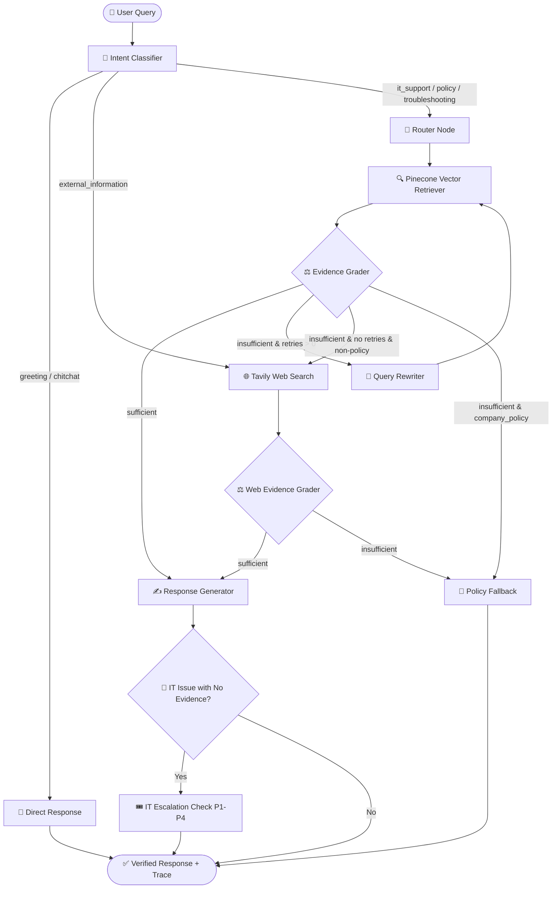

# 🛡️ Enterprise IT Support Copilot — Agentic RAG

[](https://www.typescriptlang.org/)
[](https://nodejs.org/)
[](https://react.dev/)
[](https://langchain-ai.github.io/langgraphjs/)
[](https://www.pinecone.io/)
[](https://groq.com/)
[](https://www.docker.com/)
[](https://opensource.org/licenses/MIT)

An enterprise-grade, self-correcting **Agentic Retrieval-Augmented Generation (RAG)** copilot designed to autonomously triage, troubleshoot, and resolve technical IT support inquiries, runbook tasks, and company policy questions.

Built as a full-stack TypeScript solution with **Express.js**, **React (Vite)**, orchestrated by **LangGraph.js**, powered by **Groq (`qwen/qwen3.8-27b`)**, indexed with **Pinecone Serverless Vector Search**, embedded locally via **BGE embeddings (`BAAI/bge-small-en-v1.5`)**, backed by **Tavily Web Search Fallback**, and managed via **Prisma ORM with SQLite**.

---

## 🌟 Why Agentic RAG vs Traditional RAG?

| Capability | Traditional Linear RAG | This Enterprise Agentic Copilot |
| :--- | :--- | :--- |
| **Pipeline Flow** | Fixed: Question $\rightarrow$ Search $\rightarrow$ Answer | **Dynamic cyclical state machine** with conditional branching |
| **Intent Triage** | ❌ Treats greetings and complex bugs identically | ✅ **Intent Classifier** fast-paths greetings & routes technical queries |
| **Evidence Validation** | ❌ Blindly feeds top-$k$ chunks to the LLM | ✅ **LLM-as-a-Judge grader** validates relevance before answering |
| **Query Reformulation** | ❌ If search terms miss, returns hallucinated output | ✅ **Autonomous Query Rewriter** refines keywords & retries |
| **Coverage Gaps** | ❌ Fails on live external cloud/SaaS outages | ✅ **Dynamic Web Search Fallback** (Tavily) with caution disclaimers |
| **Failure Handling** | ❌ Generic dead-end error message | ✅ **Real IT HelpDesk Escalation** (`INC-XXXXXX` P1–P4 tickets) |
| **Observability** | ❌ Black-box execution | ✅ **Real-time Agent Workflow Trace** rendered in UI |

---

## 🧠 LangGraph Workflow Architecture

The agentic pipeline is orchestrated as a state machine using **LangGraph.js (`@langchain/langgraph`)**:

```
                       ┌─────────────────────────┐
                       │       User Query        │
                       └────────────┬────────────┘
                                    │
                                    ▼
                       ┌─────────────────────────┐
                       │    Intent Classifier    │
                       └──────┬─────┬─────┬──────┘
                              │     │     │
            ┌─────────────────┘     │     └─────────────────┐
            │ greeting/chitchat     │ external_info         │ it_support / company_policy /
            ▼                       ▼                       │ technical_troubleshooting
  ┌───────────────────┐   ┌───────────────────┐             ▼
  │  Direct Response  │   │    Web Search     │   ┌───────────────────┐
  │   (No Retrieval)  │   │  (Tavily Search)  │   │    Router Node    │
  └─────────┬─────────┘   └─────────┬─────────┘   └─────────┬─────────┘
            │                       │                       │
            │                       ▼                       ▼
            │             ┌───────────────────┐   ┌───────────────────┐
            │             │  Web Doc Grader   │   │     Retriever     │
            │             └──────┬─────┬──────┘   │ (Pinecone Vector) │
            │      sufficient    │     │          └─────────┬─────────┘
            │      ┌─────────────┘     │                    │
            │      │                   │ insufficient       ▼
            │      │                   │          ┌───────────────────┐
            │      │                   │          │  Evidence Grader  │
            │      │                   │          └──────┬─────┬──────┘
            │      │                   │                 │     │
            │      │                   │       sufficient│     │ insufficient
            │      │                   │  ┌──────────────┘     │
            │      │                   │  │                    │
            │      │                   │  │         ┌──────────┴──────────┐
            │      │                   │  │         │  Retries Left > 0?  │
            │      │                   │  │         └─────┬─────────┬─────┘
            │      │                   │  │            yes│         │no
            │      │                   │  │               ▼         ▼
            │      │                   │  │      ┌──────────────┐ ┌──────────────────────┐
            │      │                   │  │      │Query Rewriter│ │ Policy intent?       │
            │      │                   │  │      └──────┬───────┘ ├──────────────────────┤
            │      │                   │  │             │         │ Yes → Fallback       │
            │      │                   │  │             ▼         │ No  → Tavily Search  │
            │      │                   │  │      (Retry Retrieve) └──────────┬───────────┘
            │      │                   │  │                                  │
            │      ▼                   │  │                                  ▼
            │  ┌───────────────────────┴──┴───┐             ┌─────────────────────────┐
            │  │      Response Generator      │             │      Fallback Node      │
            │  │ (Grounded Answers + Citations│             │   (Policy Ref / HelpDesk│
            │  │  + SOURCES_USED filtering)   │             │    Escalation Flag)     │
            │  └──────────────┬───────────────┘             └────────────┬────────────┘
            │                 │                                          │
            │                 ▼                                          │
            │  ┌──────────────────────────────┐                          │
            │  │   Escalation Check Node      │                          │
            │  │ (Triggered for unresolvable  │                          │
            │  │    IT & technical issues)    │                          │
            │  └──────────────┬───────────────┘                          │
            │                 │                                          │
            │                 ▼                                          │
            └───────────────► ┴ ◄────────────────────────────────────────┘
                              │
                              ▼
                     [Delivered to User]
```

### Mermaid Diagram



---

## ⚙️ Core Technology Stack

| Component | Technology | Rationale |
| :--- | :--- | :--- |
| **Backend Framework** | **Express.js + TypeScript** | Type-safe REST API, rate-limiting, secure middleware, and static SPA serving. |
| **Frontend Framework** | **React 18 + Vite + Tailwind CSS** | High-performance dashboard with real-time agent execution trace & incident management. |
| **Agent Orchestration**| **LangGraph.js** (`@langchain/langgraph`) | Cyclical state graph supporting deterministic edge transitions and autonomous retries. |
| **LLM Inference** | **Groq API** (`qwen/qwen3.8-27b`) | Sub-second inference latency ideal for multi-step agent reasoning pipelines. |
| **Vector Database** | **Pinecone Serverless** | 384-dimensional cosine similarity index with isolated namespace partitioning. |
| **Embeddings** | **BAAI/bge-small-en-v1.5** via `@xenova/transformers` | Local in-process embeddings (ONNX runtime) — 100% free, runs in-memory with zero API cost. |
| **Live Web Fallback** | **Tavily Search API** | Real-time search for cloud/SaaS outages with security warning disclaimers. |
| **Database & ORM** | **Prisma ORM + SQLite** | Structured storage for users, chat history, documents, audit logs, and tickets. |
| **Containerization** | **Docker & Docker Compose** | Multi-stage production container ready for cloud deployment (Render, Railway, VPS). |

---

## 🔑 Environment Variables Required

Create `packages/backend/.env` using the template below (or copy from `.env.example`):

```bash
# ==============================================================================
# Enterprise IT Support Copilot - Environment Configuration
# ==============================================================================

# ── LLM Provider (Groq API - High Speed Inference) ───────────────────────────
# Get free API key at: https://console.groq.com/keys
GROQ_API_KEY=gsk_your_groq_api_key_here
GROQ_MODEL=qwen/qwen3.8-27b

# ── Local Embeddings (Xenova / BAAI BGE-Small) ────────────────────────────────
# Uses @xenova/transformers locally (100% free, runs in-process, 384 dimensions)
HF_EMBEDDING_MODEL=BAAI/bge-small-en-v1.5

# ── Vector Database (Pinecone Serverless) ─────────────────────────────────────
# Create free index at: https://app.pinecone.io/ (dimension: 384, metric: Cosine)
PINECONE_API_KEY=pcsk_your_pinecone_api_key_here
PINECONE_INDEX_NAME=it-copilot
PINECONE_NAMESPACE=company-it-kb

# ── Web Search Tool (Tavily Search API) ───────────────────────────────────────
# Get free API key (1,000 queries/mo) at: https://app.tavily.com/
TAVILY_API_KEY=tvly-your_tavily_api_key_here

# ── Application Security & Authentication ─────────────────────────────────────
# Generate with: node -e "console.log(require('crypto').randomBytes(32).toString('hex'))"
JWT_SECRET=your_jwt_secret_minimum_32_characters_long
ADMIN_API_KEY=your_admin_api_key_secret_here

# ── Auto Admin Setup (used by scripts/create-admin.mjs) ───────────────────────
ADMIN_EMAIL=admin@company.com
ADMIN_PASSWORD=AdminPassword123!
ADMIN_NAME=IT Admin

# ── Server Configuration ──────────────────────────────────────────────────────
PORT=3001
NODE_ENV=development
FRONTEND_URL=http://localhost:5173
```

---

## 🛠️ Setup Instructions

### 1. Prerequisites
- **Node.js 20+** installed
- Free API keys from:
  - [Groq Console](https://console.groq.com/keys)
  - [Pinecone](https://app.pinecone.io/) (create index: `it-copilot`, 384 dimensions, Cosine metric)
  - [Tavily Search](https://app.tavily.com/)

### 2. Clone and Install Dependencies
```bash
git clone https://github.com/JYOTSANA10/Agentic-RAG.git
cd Agentic-RAG
npm install
```

### 3. Configure Environment
```bash
cp .env.example packages/backend/.env
# Edit packages/backend/.env with your API keys
```

### 4. Push Database Schema & Create Admin
```bash
cd packages/backend
npx prisma db push
ADMIN_EMAIL=admin@company.com ADMIN_PASSWORD=AdminPassword123! node scripts/create-admin.mjs
cd ../..
```

### 5. Start the Application
Run both frontend and backend concurrently in separate terminals:

```bash
# Terminal 1: Backend API (port 3001)
npm run dev:backend

# Terminal 2: Frontend Client (port 5173)
npm run dev:frontend
```

Open **`http://localhost:5173`** in your browser.

### 6. Single-Command Docker Deployment
```bash
docker compose up --build -d
```
The application will be live at `http://localhost:3001`.

---

## 📡 API Endpoints Reference

### Authentication Endpoints (`/api/auth`)
*Rate limited: 10 requests per 15 minutes per IP*

| Method | Endpoint | Access | Description |
| :--- | :--- | :--- | :--- |
| `POST` | `/api/auth/register` | Public | Register new user account (`email`, `password`, `name`). Returns JWT & profile. |
| `POST` | `/api/auth/login` | Public | Authenticate user credentials. Returns JWT token. |
| `GET` | `/api/auth/me` | Authenticated | Retrieve profile details of currently logged-in user. |

### Chat & Copilot Endpoints (`/api/chat`)
*Rate limited: 30 requests per minute per IP*

| Method | Endpoint | Access | Description |
| :--- | :--- | :--- | :--- |
| `POST` | `/api/chat` | Authenticated | Execute agentic RAG query (`question`, optional `conversationId`, `allowWebFallback`). Returns answer, citations, trace steps, and escalation flags. |
| `GET` | `/api/chat/conversations` | Authenticated | List previous conversations for the authenticated user (paginated, latest 50). |
| `GET` | `/api/chat/conversations/:id` | Authenticated | Retrieve full conversation thread with stored message history, citations, and traces. |

### Document Ingestion Endpoints (`/api/ingest` & `/api/documents`)
*Rate limited: 5 requests per minute for ingest*

| Method | Endpoint | Access | Description |
| :--- | :--- | :--- | :--- |
| `POST` | `/api/ingest` | Admin only | Multipart upload (`.pdf`, `.docx`, `.txt`, `.md`). Early SHA-256 hash check prevents duplicate processing before chunking and Pinecone upsert. |
| `GET` | `/api/documents` | Admin only | List all uploaded documents with chunk counts, file sizes, and ingest timestamps. |
| `DELETE` | `/api/documents/:id` | Admin only | Remove document record from SQLite and delete associated vector chunks from Pinecone. |

### IT Support Ticket Endpoints (`/api/tickets`)
*Real backend ticketing system with collision-proof `INC-XXXXXX` references*

| Method | Endpoint | Access | Description |
| :--- | :--- | :--- | :--- |
| `POST` | `/api/tickets` | Authenticated | Create an IT ticket (`question`, `description`, `priority`: `P1`–`P4`). Auto-generates unique `INC-XXXXXX` reference. |
| `GET` | `/api/tickets` | Authenticated | List paginated tickets submitted by the authenticated user. |
| `GET` | `/api/tickets/:id` | Owner / Admin | Retrieve full ticket record including status, priority, and timestamps. |
| `PATCH` | `/api/tickets/:id/status` | Admin only | Update ticket status (`open`, `in_progress`, `resolved`). |

### System & Audit Endpoints
*General API rate limited: 100 requests per minute*

| Method | Endpoint | Access | Description |
| :--- | :--- | :--- | :--- |
| `GET` | `/api/health` | Public | Returns system uptime, version (`2.0.0-agentic-rag-v2`), and dependency health. |
| `GET` | `/api/audit` | Admin only | View audit trail containing query latencies, token consumption, and retries. |

---

## 🧪 Testing

The backend test suite is written with **Vitest** with mocked external services (Pinecone, Groq, Tavily, Prisma, JWT):

```bash
# Run all unit and integration tests
cd packages/backend
npx vitest run

# Run tests with verbose output
npx vitest run --reporter=verbose

# Run specific test file
npx vitest run src/__tests__/tickets.test.ts
npx vitest run src/__tests__/auth.test.ts
npx vitest run src/__tests__/workflow.test.ts

# Run TypeScript compilation check
npx tsc --noEmit
```

### Test Suite Overview

- `workflow.test.ts`: Evidence Grader, Retriever, Query Rewriter, Web Search, and RAG Workflow Conditional Routing (`afterGrade`, `afterWebGrade`).
- `intentClassifier.test.ts`: Keyword fast-path greetings, LLM intent triage, trace step verification, and AgentState defaults.
- `citations.test.ts`: Citation deduplication, grounded citations extraction (`SOURCES_USED`), hallucination prevention, and fallback escalation.
- `tickets.test.ts`: Unique `INC-XXXXXX` ticket reference generation, collision-retry handling, priority validation (`P1`–`P4`), and ticket API handlers.
- `auth.test.ts`: `authenticateToken` 401 status checks on missing tokens, expired tokens, non-existent database users, and `requireAdmin` 403 authorization.

---

## ⚠️ Known Limitations

1. **SQLite Database Concurrency**: SQLite is utilized for zero-setup local deployment and rapid prototyping. It relies on file-level locks; for high-concurrency production deployments with multiple backend replicas, configure Prisma to connect to **PostgreSQL** or **MySQL**.
2. **Render Free Tier Cold Starts**: Deployments hosted on Render's free tier enter sleep mode after 15 minutes of inactivity. The initial wake-up request can take 30–60 seconds due to server spinning and loading the in-process `@xenova/transformers` model into memory.

---

## 📄 License

This project is licensed under the MIT License — see the [LICENSE](LICENSE) file for details.
